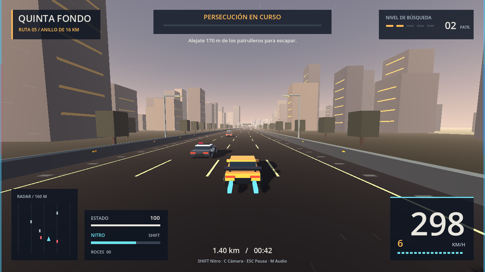

# Quinta Fondo

**Quinta Fondo es un juego de carreras 3D hecho en Godot.**

El proyecto apunta a conducción arcade, carreras urbanas y persecuciones en un
mundo abierto, con identidad y contenido originales.

Código abierto bajo licencia MIT.

## Estado

MVP jugable de una persecución policial en una autopista circular de **16 km**.
La ruta tiene cuatro carriles, tráfico, barreras y un entorno urbano procedural.
Los tramos se cargan alrededor del auto, con origen móvil y una caché acotada al
circuito; se puede dar vueltas sin llegar a un final.

- Conducción arcade, frenado, derrape y nitro recargable.
- Dos patrulleros iniciales que persiguen, intentan encerrar y esquivan tráfico;
  el nivel de búsqueda aumenta cada 25 segundos, hasta cuatro unidades.
- Colisiones con daño, radar, estado del auto y recompensa de nitro al pasar
  cerca de otro vehículo sin chocarlo.
- Cámara con FOV progresivo, inclinación, vibración, estelas periféricas,
  escapes de nitro y sonido de motor, viento, sirenas e impactos.
- Menú inicial, pausa, escape, captura y reinicio; español e inglés nativos.

La referencia de diseño es la persecución arcade de *Need for Speed: Most
Wanted*. Los modelos, el escenario, los textos y los sonidos de este MVP son
originales y se generan con recursos nativos de Godot. El alcance actual es
una persecución; las carreras urbanas, el garaje y el mundo abierto quedan
para etapas posteriores.



## Cómo jugar

Presionar **Enter** o el botón de inicio. Alejarse **170 m** de todos los
patrulleros y mantener esa distancia **8 segundos** para escapar. Conducir
despacio, cercado por la policía durante **5 segundos**, o agotar el estado
del auto termina la partida. La pantalla de resultado permite volver a jugar.

| Control | Acción |
| --- | --- |
| W / ↑ | Acelerar |
| A D / ← → | Doblar |
| S / ↓ / Espacio | Frenar; al girar también permite derrapar |
| Shift | Nitro; soltar al agotarlo para volver a activarlo tras recargar |
| C | Alternar distancia de la cámara |
| Esc / Enter en pausa | Pausar / continuar |
| R | Reiniciar la persecución |
| M | Silenciar / activar el sonido |

El nitro recarga con el tiempo. Los roces limpios recuperan carga extra.
Usar los cuatro carriles y aprovechar el tráfico ayuda a perder a los patrulleros.

## Abrir y ejecutar

Requiere **Godot 4.7.2 estándar**, con GDScript. Se utiliza el renderizador
Compatibility y Jolt Physics.

1. Clonar el repositorio:

   ```sh
   git clone https://github.com/gstn-caruso/quinta-fondo.git
   cd quinta-fondo
   ```

2. Importar `project.godot` desde Godot o ejecutar:

   ```sh
   godot --editor --path .
   ```

3. Presionar **F6** para ejecutar la escena abierta o **F5** para ejecutar el
   proyecto.

El idioma se toma del sistema operativo: español e inglés, con español como
alternativa para otros idiomas. Los textos se mantienen en
`assets/i18n/messages.csv`; se versionan también los catálogos `.translation`.

## Estructura

- `scenes/`: escenas del juego.
- `scripts/`: conducción, autopista, tráfico y policía, cámara, interfaz, audio
  procedural y servicio de idioma.
- `assets/`: icono, traducciones y futuros recursos del juego.
- `tests/`: pruebas de integración de entrada, traducciones, conducción,
  colisiones continuas, captura/escape, reinicio y recorrido de todo el circuito.
- `tools/`: verificación, exportación, empaquetado y publicación.
- `licenses/`: avisos del motor y sus dependencias.

## Desarrollo y verificación

Usar ramas `feature/<nombre>` y PRs hacia `main`. Los títulos de PR siguen
Conventional Commits y se integran mediante squash.

Con Godot disponible como `godot`:

```sh
python3 -m unittest discover -s tools -p 'test_*.py'
GODOT=godot python3 tools/check.py
```

También se puede usar `python3 tools/install_godot.py` para descargar el editor
y las plantillas oficiales fijadas en `release-config.json`. El instalador
verifica los SHA-512 y muestra las rutas de los ejecutables y plantillas.

Para reproducir la revisión visual con el renderizador real:

```sh
godot --path . --fixed-fps 60 --script res://tools/preview.gd -- ready
godot --path . --fixed-fps 60 --script res://tools/preview.gd -- boost
```

Las capturas quedan en `build/previews/`. En Linux sin pantalla se puede
anteponer `xvfb-run -a`. La vista `boost` coloca los vehículos para revisar
la composición; las pruebas de integración verifican además las partidas
con la simulación y la IA reales.

El manejo utiliza coordenadas longitudinales y laterales de la ruta, con
colisiones barridas entre autos, en lugar de una simulación de suspensión.
Los efectos de velocidad funcionan con el renderizador Compatibility y no
requieren desenfoque de movimiento.

## Compilaciones y versiones

GitHub Actions verifica cada PR, genera los paquetes e inicia el ejecutable de
Windows en un runner Windows. Cada integración en `main` publica una versión
SemVer después de completar esas verificaciones:

- Primera versión: `0.1.0`.
- Cambios incompatibles (`!` o `BREAKING CHANGE:`): incrementan major.
- `feat`: incrementa minor.
- Otros cambios: incrementan patch.

Las [publicaciones](https://github.com/gstn-caruso/quinta-fondo/releases)
incluyen un instalador Linux amd64 `.deb`, ZIPs portables para Linux y Windows,
un ejecutable Windows x86_64 `.exe` y `SHA256SUMS.txt`. Los ejecutables exportados
no requieren instalar Godot.

La versión del motor, los nombres de las exportaciones y las pruebas están en
`release-config.json`. Los resultados se generan en `build/`, excluido de Git.

## Licencia

El código y los recursos originales del proyecto se distribuyen bajo
[licencia MIT](LICENSE). Los avisos de Godot y de sus dependencias se conservan
en [THIRD_PARTY_NOTICES.md](THIRD_PARTY_NOTICES.md) y `licenses/`.
